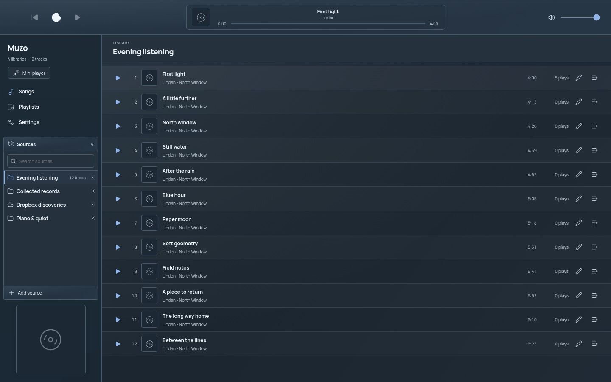
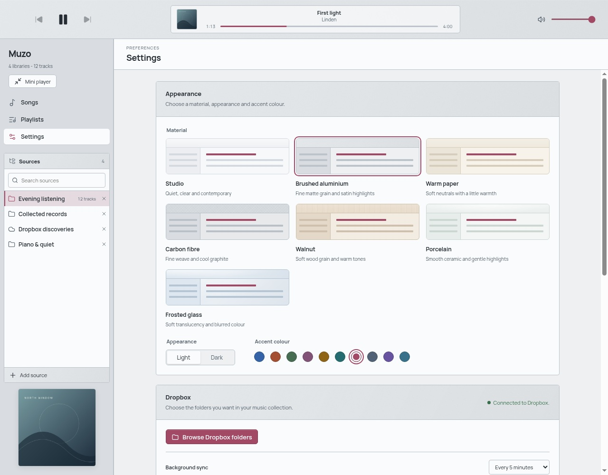

# Muzo

Your music, from your folders and Dropbox, in one desktop player.

Build a library, make a playlist and settle into an album. Muzo keeps your
collection in sync, remembers your artwork and gives you a workspace you can
make your own.



*The desktop player, shown with fictional tracks and original demo artwork.*

[Download Muzo](https://alexanderwanyoike.github.io/muzo/#downloads) ·
[Release notes](https://github.com/alexanderwanyoike/muzo/releases) ·
[Report a problem](https://github.com/alexanderwanyoike/muzo/issues)

## Make yourself at home

- **Bring your music.** Add local folders or browse and select folders from Dropbox.
- **Keep things organised.** Search your sources, build playlists and see what is coming up in the playback queue.
- **Keep a little player nearby.** Switch to the rounded mini player with album artwork and an optional queue.
- **Make it yours.** Choose from seven materials, light or dark appearances and ten accent colours.
- **Enjoy your album covers.** Embedded artwork is cached locally so it is ready when you return.

## Download and listen

Choose your platform on the [download page](https://alexanderwanyoike.github.io/muzo/#downloads),
or get the same files from [GitHub Releases](https://github.com/alexanderwanyoike/muzo/releases/latest).
You do not need to build Muzo yourself.

| Platform | Package | Open it |
| --- | --- | --- |
| Windows | x64 installer (`.exe`) | Run the installer. |
| macOS | Apple silicon or Intel disk image (`.dmg`) | Open the disk image and drag Muzo into Applications. |
| Linux | x64 AppImage | Allow the file to run as a program, then open it. |

Muzo is an early desktop preview. Packages are currently unsigned, and macOS
builds are not notarized, so your operating system may show a security prompt.
Checksums are included with each release.

1. Open **Settings** and add a music folder. Subfolders are included automatically.
2. Choose a source under **Sources**, then play a song or build a playlist.
3. Explore **Appearance** in Settings to find a material and accent you like.

Removing a source from Muzo leaves your music files in place.

<details>
<summary>Connecting Dropbox</summary>

Create a scoped app in the [Dropbox App Console](https://www.dropbox.com/developers/apps)
with Full Dropbox access and the `files.metadata.read` and `files.content.read`
permissions. In Muzo Settings, enter its public app key, choose Connect Dropbox,
approve access in your system browser, then paste the displayed authorization code.
No client secret or redirect URI is needed. Enable your OS keyring for encrypted
credential storage. Muzo refuses Linux basic_text storage.

Choose Browse Dropbox folders, navigate with the breadcrumbs, and select one or
several folders. Selections stay with you as you browse. Add the selected folders
to create libraries using their folder names; subfolders are included automatically.
Already-added folders are marked, and failed additions remain selected for retry.
Choose Entire Dropbox if you want the account root. Each library syncs on startup
and at the interval set in Settings. Refresh under Indexed sources runs a
sync immediately. Each library stays bound to the account that created it.

Dropbox tracks download when selected, then use the normal playback controls.
Downloads require an internet connection, and retained audio is capped at 1 GiB.
Disconnect removes local account credentials. Access can also be revoked through
Dropbox's connected-app settings. Live Dropbox access requires your own app key
and consent; automated tests exercise the API boundary with fixtures.


</details>

<details>
<summary>A look at personalisation</summary>



Studio, Brushed aluminium, Warm paper, Carbon fibre, Walnut, Porcelain and Frosted
glass each have light and dark variants. Frosted glass softens the artwork inside
the app; the desktop window remains opaque. Your choices are saved between sessions.

</details>

## Feedback and contributions

Found something that feels off? [Open an issue](https://github.com/alexanderwanyoike/muzo/issues)
with your operating system, Muzo version and what happened. Screenshots are welcome.

Muzo is built with Electron, React and TypeScript. To work on it, install
Node.js 22.12 or newer and Yarn Classic 1.22.22 or newer, then run:

```sh
yarn install
yarn desktop:dev
```

Linux development and native tests need Electron's GTK/audio runtime dependencies
and Xvfb. CI lists the required system packages.

| Check | Command |
| --- | --- |
| Formatting | `yarn format:check` |
| Lint | `yarn lint` |
| Types | `yarn typecheck` |
| Tests | `yarn test` |
| Desktop build | `yarn desktop:build` |
| Package and distributables | `yarn desktop:package` and `yarn desktop:make` |
| Website | `yarn site:verify` and `yarn site:build` |

Start feature branches from `dev` and target PRs at `dev`. Releases promote `dev`
to `main`. We use merge commits and preserve the red, green and refactor commits.
See [AGENTS.md](./AGENTS.md) for the engineering conventions.

- [Desktop smoke tests](./docs/testing/desktop-ui-smoke-test.md)
- [Native packaging and releases](./docs/distribution.md)
- [Project site](./docs/project-site.md)
- [Planned and completed work](./docs/cards)
- [Architecture decisions](./docs/adr)
- [Screenshot provenance](./docs/screenshots.md)

## License

Muzo is [MIT licensed](./LICENSE). Bundled fonts, icons and runtime components
retain their own licences and notices.
