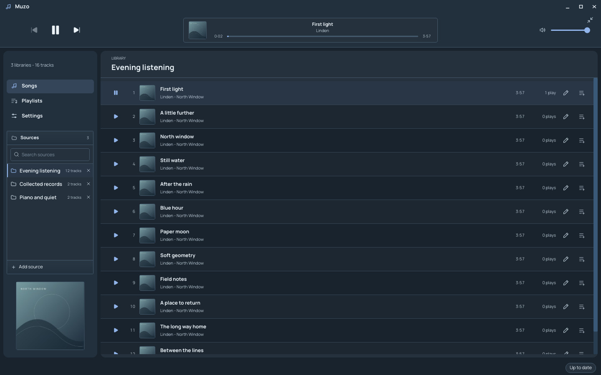
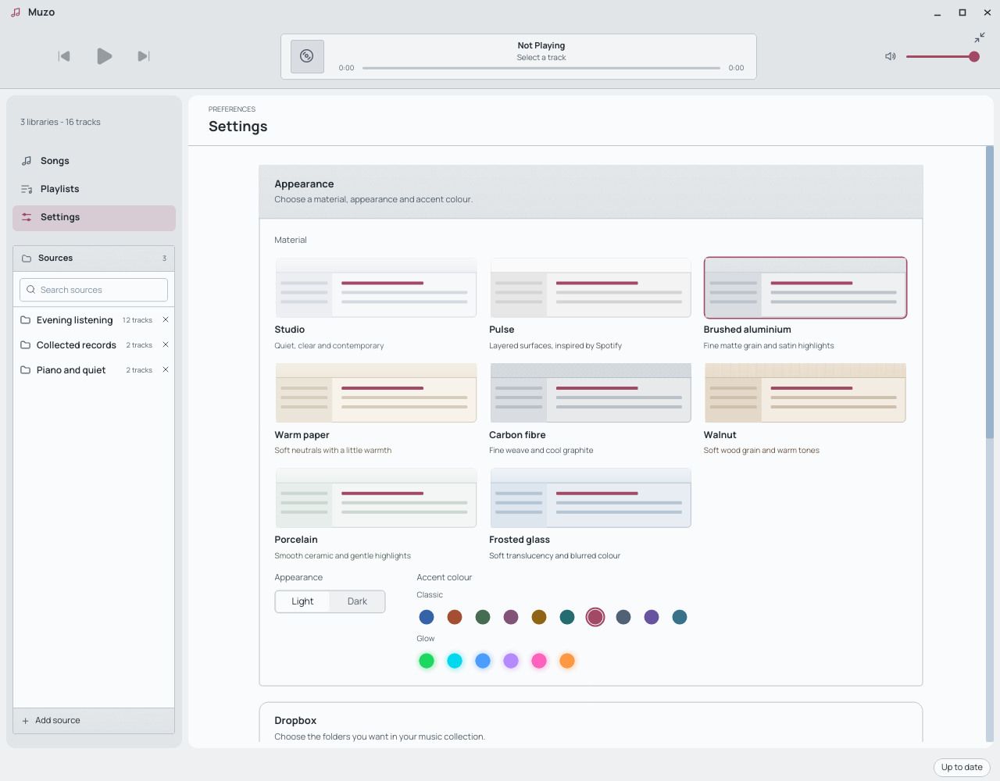

# Muzo

Muzo is a native desktop music player for local folders and Dropbox, built with Rust and Iced.

Build a library, make a playlist and settle into an album. Muzo keeps your
collection in sync, remembers your artwork and gives you a workspace you can
make your own.



*The desktop player, shown with fictional tracks and original demo artwork.*

[Download Muzo](https://muzo.alphaneuron.net/#downloads) ·
[Release notes](https://github.com/alexanderwanyoike/muzo/releases) ·
[Report a problem](https://github.com/alexanderwanyoike/muzo/issues)

## Make yourself at home

- **Bring your music.** Add local folders or browse and select folders from Dropbox.
- **Keep things organised.** Search your sources, build playlists and see what is coming up in the playback queue.
- **Keep a little player nearby.** Switch to the mini player with album artwork and an optional queue.
- **Make it yours.** Choose from eight materials, light or dark appearances and sixteen accent colours.
- **Enjoy your album covers.** Embedded artwork is cached locally so it is ready when you return.

## Download and listen

Choose your platform on the [download page](https://muzo.alphaneuron.net/#downloads),
or get the same files from [GitHub Releases](https://github.com/alexanderwanyoike/muzo/releases/latest).
You do not need to build Muzo yourself.

| Platform | Package | Open it |
| --- | --- | --- |
| Windows | x64 installer (`.exe`) | Run the installer. |
| macOS | Apple silicon or Intel disk image (`.dmg`) | Open the disk image and drag Muzo into Applications. |
| Linux | x64 AppImage | Allow the file to run as a program, then open it. |

Muzo 1.0.0 is the first stable release. The installers are unsigned, and macOS
builds are unnotarized. Each release includes checksums.

If you upgrade from v0.0.6, Muzo imports your libraries, playlists, play history,
metadata edits and appearance settings on first launch.

1. Open **Settings** and add a music folder. Subfolders are included automatically.
2. Choose a source under **Sources**, then play a song or build a playlist.
3. Explore **Appearance** in Settings to find a material and accent you like.

Removing a source from Muzo leaves your music files in place.

Updater-enabled builds check for newer releases automatically. The small update
pill at the bottom right of the application status bar shows checks, available
versions and download progress. Click it to download, then choose **Restart to
install** when you are ready. Playback continues during the download. Windows installers
and Linux AppImages can update in place; the AppImage keeps its existing filename
and location. Unsigned macOS builds open the release page for manual installation.

<details>
<summary>Connecting Dropbox</summary>

Create a scoped app in the [Dropbox App Console](https://www.dropbox.com/developers/apps)
with Full Dropbox access and the `files.metadata.read` and `files.content.read`
permissions. In Muzo Settings, enter its public app key and choose **Connect Dropbox**.
Approve access in your system browser, paste the authorization code into Muzo and
choose **Finish connecting**. No client secret or redirect URI is needed. Enable
your OS keyring for encrypted credential storage. Muzo refuses Linux basic_text
storage.

Choose **Browse folders**. Open folders by name or choose **Parent folder** to go
back. Check the folders you want to add. To add the account root, use **Select this
folder** while viewing Dropbox at the top level. Selections stay with you as you
browse. Use **Add 1 folder** or **Add N folders** to create libraries using the
folder names, including their subfolders. Already-added folders are marked, and
failed additions remain selected for retry. Each library syncs on startup and at
the interval set in Settings. **Sync now** starts a sync immediately. Each library
stays bound to the account that created it.

Dropbox tracks download when selected, then use the normal playback controls.
Downloads require an internet connection, and retained audio is capped at 1 GiB.
Disconnect removes local account credentials. Access can also be revoked through
Dropbox's connected-app settings. Live Dropbox access requires your own app key
and consent; automated tests exercise the API boundary with fixtures.


</details>

<details>
<summary>A look at personalisation</summary>



Studio, Pulse, Brushed aluminium, Warm paper, Carbon fibre, Walnut, Porcelain and
Frosted glass each have light and dark variants. Your choices are saved between sessions.

</details>

## Feedback and contributions

Found something that feels off? [Open an issue](https://github.com/alexanderwanyoike/muzo/issues)
with your operating system, Muzo version and what happened. Screenshots are welcome.

Install Rust 1.95 or newer,
Node.js 22.12 or newer and Yarn Classic 1.22.22 or newer, then run:

```sh
yarn install
yarn desktop:dev
```

On Debian and Ubuntu, install the ALSA, Wayland and xkbcommon development
packages (`libasound2-dev`, `libwayland-dev` and `libxkbcommon-dev`).
The packaged Linux startup check uses Xvfb. CI lists the required system packages.

| Check | Command |
| --- | --- |
| Rust formatting | `yarn workspace @muzo/desktop-rust format:check` |
| JavaScript formatting | `yarn format:check` |
| Lint | `yarn lint` |
| Types | `yarn typecheck` |
| Tests | `yarn test` |
| Rust build | `yarn desktop:build` |
| Native installer | `yarn desktop:package`, `yarn desktop:make`, or `yarn desktop:distribute` |
| Website | `yarn site:verify` and `yarn site:build` |

Start feature branches from `dev` and target PRs at `dev`. Releases promote `dev`
to `main`. We use merge commits and preserve the red, green and refactor commits.
See [AGENTS.md](./AGENTS.md) for the engineering conventions.

- [Native desktop smoke tests](./docs/testing/desktop-ui-smoke-test.md)
- [Native packaging and releases](./docs/distribution.md)
- [Project site](./docs/project-site.md)
- [Architecture decisions](./docs/adr)
- [Screenshot provenance](./docs/screenshots.md)

## License

Muzo is [MIT licensed](./LICENSE). Bundled fonts, icons and runtime components
retain their own licences and notices.
